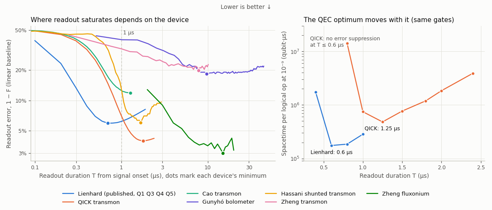

# Do the paper's readout results hold on other devices? (not in the paper)

The paper's readout and discriminator results all come from one chip, the five-qubit Lienhard et al. dataset. This
study runs the same analyses on public data from other devices.

**Result: the patterns hold, the numbers do not.** Fidelity still rises, saturates and flattens or slowly declines,
small models still match a large one at the plateau, and QEC spacetime still has a sharp optimum. But the durations
are properties of the device. QICK saturates at 1.8 µs and has its QEC optimum at 1.25 µs, where the paper has 0.5-1.7 µs
and 600-800 ns. The likely reason is ring-up: the state contrast reaches 90% of its maximum in 0.13-0.38 µs on the Lienhard qubits,
against 0.68 µs on QICK and 0.58 µs on Cao.

MCMit-T was stopped after one run, so every statement about "large models" here means the Baseline FNN.

**Report with plots of the main differences:** [`report.pdf`](report.pdf).



## Check of each takeaway

| Paper's claim | QICK | Cao | Other devices | Verdict |
|---|---|---|---|---|
| **#1** Fidelity saturates by about 1 µs and declines beyond it (per qubit, peaks at 0.5-1.7 µs) | Peak at 1.8 µs; error at 1 µs is 1.8x the peak's; -0.2 pp by 2.4 µs | Saturates near 1.3 µs, where the trace ends | Hassani about 1.7 µs, Zheng transmon about 7 µs, fluxonium about 12 µs, bolometer about 10 µs | Shape holds, duration does not transfer |
| **#2** The first 0.5 µs holds most information; any delay costs fidelity | 500 ns window: 0.74 at the start, 0.93 centred at 1.03 µs (0.72 at the start with the filter of the published windows) | 0.71 at the start, 0.88 centred at 0.74 µs (0.69 with that filter) | Hassani 0.54 to 0.93; bolometer also rises | Does not transfer |
| **#3** Cutting to about 600 ns costs about 10% more error | CNN: 4.2x at 600 ns, 1.6x at 1 µs, 1.04x at 1.5 µs | 1.8x at 600 ns, 1.05x at 1 µs | | Principle holds, the 600 ns does not |
| **#4** The smallest capable models match or beat much larger ones | CNN and KLiNQ match the FNN from 1 µs up; HERQULES from 1.25 µs | Same: all tie from 1.2 µs | | Holds at the plateau, against the FNN only |
| **#5** At 1 µs about 80% of errors are state changes, at most 20% overlap | 91% overlap at 1 µs, 17% at 1.5 µs, 7% at 1.8 µs | 26% at 1 µs, 18% at 1.2 µs | | Holds at each device's plateau, not at a fixed 1 µs |
| **#9** 600-800 ns is the spacetime optimum, 0.6x of 1 µs; Λ collapses below it | Optimum at 1.25 µs, 0.65x of 1 µs; 29x at 800 ns, no suppression at 600 ns | Not simulated (labels limit its error) | | Shape holds, location moves |

Takeaways #10-#14 (decoders, workloads, soft information) were not tested. The second half of #2, "truncate, do not slide",
partly survives. For a fixed end time, integrating longer is still better than a short late window (QICK: 0.95 at 1.3 µs
against 0.93 for the 500 ns window ending there). But skipping the first 200 ns helps the linear baseline: on QICK from 0.805
to 0.833 at 600 ns and from 0.929 to 0.939 at 1 µs, and on Cao similarly. The effect is small on the Lienhard chip (at most 0.6 pp at
600 ns, 0.1 pp at 1 µs). The learned models already do this: the CNN reaches 0.844 at 600 ns on QICK.

## Data

| Dataset | Device | Use | Size used |
|---|---|---|---|
| [Di Guglielmo et al. 2025](https://zenodo.org/records/14427490) (QICK) | 1 transmon | Everything | 1,000,000 shots, 769 samples at 3.25 ns |
| [Cao et al. 2025](https://doi.org/10.7910/DVN/DPMID3), `natural_decay` | 1 transmon | Everything but QEC | 207,179 heralded g/e shots, delays up to 750 ns, 68 samples |
| [Hassani et al. 2023](https://zenodo.org/records/8004359), Fig. 7b | Inductively shunted transmon | Readout sweeps | 501 shots per state at each of 13 powers |
| [Gunyhó et al. 2024](https://zenodo.org/records/10000511), run 76 | Transmon read by a bolometer | Readout sweeps | 2,000 shots at 64 ns |
| [Zheng et al. 2026](https://zenodo.org/records/23367046) | Transmon and fluxonium | True duration sweep | 8,000-8,192 integrated shots per state and duration |

Checks against the sources: QICK peaks at F = 0.960, the paper's 96%. The bolometer gives F = 0.816, which is 2F-1 = 0.63
against the paper's 0.618. After heralding, Cao's prep_g, prep_e and prep_f read 96%, 86% and 67% in their own blob at zero delay.

**Control.** The Lienhard channels went through the same single-qubit code, one demodulated channel at a time. Against
Table 2 at T >= 600 ns (90 cells) the median difference is 0.11 pp. The largest are explained below. Do not use the control at
T <= 400 ns: its cached channels carry the 10 MHz filter, whose delay of about 30 ns costs 1-6 pp there. QICK and Cao are not
affected, because only HERQULES filters them, as its recipe does.

## Results

Assignment fidelity, as in the paper. Test sets are 100,000 shots (QICK) and 41,733 shots (Cao). Across three training seeds
the standard deviation is at most 0.02 pp on QICK and 0.05 pp on Cao.

**QICK**

| Model (params at 1 µs) | 200 | 400 | 600 | 800 | 1000 | 1250 | 1500 | 1800 | 2000 | 2400 ns |
|---|---|---|---|---|---|---|---|---|---|---|
| Linear (5) | 0.551 | 0.680 | 0.806 | 0.887 | 0.929 | 0.950 | 0.958 | 0.960 | 0.960 | 0.958 |
| QubiCML (65) | 0.551 | 0.680 | 0.806 | 0.887 | 0.929 | 0.951 | 0.959 | 0.960 | 0.960 | 0.958 |
| HERQULES (292) | 0.547 | 0.692 | 0.830 | 0.906 | 0.940 | 0.956 | 0.961 | 0.962 | 0.963 | 0.963 |
| KLiNQ (705) | 0.563 | 0.716 | 0.845 | 0.912 | 0.942 | 0.956 | 0.961 | 0.963 | 0.963 | 0.963 |
| MCMit-CNN (2,609) | 0.563 | 0.698 | 0.844 | 0.908 | 0.942 | 0.957 | 0.961 | 0.962 | 0.963 | 0.963 |
| Baseline FNN (238,856) | 0.563 | 0.715 | 0.844 | 0.912 | 0.942 | 0.956 | 0.960 | 0.961 | 0.962 | 0.962 |

MCMit-T has one run: 0.713 at 400 ns.

**Cao**

| Model | 200 | 400 | 600 | 800 | 1000 | 1200 | 1360 ns |
|---|---|---|---|---|---|---|---|
| Linear | 0.528 | 0.642 | 0.774 | 0.847 | 0.872 | 0.881 | 0.882 |
| QubiCML | 0.530 | 0.643 | 0.776 | 0.851 | 0.877 | 0.885 | 0.886 |
| HERQULES | 0.525 | 0.653 | 0.797 | 0.870 | 0.889 | 0.895 | 0.896 |
| KLiNQ | 0.542 | 0.684 | 0.819 | 0.876 | 0.891 | 0.896 | 0.897 |
| MCMit-CNN | 0.539 | 0.671 | 0.818 | 0.874 | 0.891 | 0.895 | 0.897 |
| Baseline FNN | 0.541 | 0.685 | 0.819 | 0.877 | 0.891 | 0.896 | 0.896 |

Cao's fidelity sits near 0.90 mainly because of its labels: heralding errors and decay leave about 15% of the
prep_e shots outside the e blob.

**Paired differences from the FNN on the shared test shots** (pp, stratified bootstrap, 95% CI). "tie" means the CI contains 0.

| QICK | 400 | 600 | 800 | 1000 | 1250 | 1500 | 1800 | 2400 ns |
|---|---|---|---|---|---|---|---|---|
| MCMit-CNN | -1.70 | tie | -0.32 | tie | +0.08 | +0.13 | +0.11 | +0.11 |
| HERQULES | -2.30 | -1.40 | -0.61 | -0.20 | tie | +0.11 | +0.09 | +0.12 |
| KLiNQ | tie | +0.09 | tie | +0.06 | +0.07 | +0.14 | +0.12 | +0.11 |

| Cao | 400 | 600 | 800 | 1000 | 1200 | 1360 ns |
|---|---|---|---|---|---|---|
| MCMit-CNN | -1.33 | tie | -0.25 | tie | tie | tie |
| HERQULES | -3.12 | -2.27 | -0.69 | -0.17 | tie | tie |
| KLiNQ | tie | tie | tie | tie | tie | tie |

Read the +0.1 pp on QICK as "match", not "beat". The FNN draws from a 320,000-shot subsample, as in the paper's protocol, and the CNN, HERQULES and KLiNQ train on
585,000-810,000. On Cao, which is smaller than that limit, the difference disappears. Below the plateau, KLiNQ is the small model
that keeps up with the FNN, and HERQULES trails furthest of the three, as it does in Table 2.

**Overlap against everything else** (`error_modes.py`). A proxy for the paper's HMM pipeline: Gaussian overlap fitted to the
far side of each state's score distribution, as a share of the CNN's error.

| Device | 600 ns | 1 µs | Later |
|---|---|---|---|
| QICK | 100% | 91% | 17% at 1.5 µs, 7% at 1.8 µs |
| Cao | 100% | 26% | 18% at 1.2 µs |
| Lienhard Q1, Q3, Q5, pooled | | 12% (paper: at most 17%) | |
| Lienhard Q2 | 83% | 87% (paper: SNR-bound) | |

Per qubit the proxy is rougher: 32%, 8%, 1% on Q1, Q3, Q5 against the paper's 19%, 20%, 9%. At QICK's plateau the errors are also
asymmetric, P(0|1) = 5.0% against P(1|0) = 2.5%, and its authors report a thermal population up to about 1.6% and a pi-pulse error up to about 0.4%.

**QEC** (`sweep_qec.py`). The (T, error) pairs of the CNN through `system/sweep_ler.py` and the fit of `system/analyze.py`, with
the paper's circuit and `ibm_boston` preset. Only the readout changes, so this is "these gates with that readout", not the source device.

| Readout | T (ns) | Readout error | Λ | d at 1e-9 | Spacetime (qubit·µs) |
|---|---|---|---|---|---|
| Lienhard (published) | 400 | 7.9% | 1.49 | 105 | 1,730,000 |
| | **600** | 5.1% | 2.49 | 45 | **175,000** |
| | 800 | 4.5% | 2.61 | 43 | 185,000 |
| | 1000 | 4.3% | 2.41 | 47 | 284,000 |
| QICK | 600 | 15.6% | no suppression | | |
| | 800 | 9.2% | 1.27 | 183 | 14,000,000 |
| | 1000 | 5.8% | 1.91 | 65 | 747,000 |
| | **1250** | 4.3% | 2.20 | 53 | **482,000** |
| | 1500 | 3.9% | 2.03 | 59 | 768,000 |
| | 1800 | 3.8% | 1.93 | 65 | 1,190,000 |
| | 2400 | 3.7% | 1.62 | 89 | 3,910,000 |

HERQULES gives the same optimum on QICK, with the same d = 53. The linear baseline's minimum is also at 1.25 µs (d = 61). The optimum stops short of
the readout peak (1.8 µs), because every extra nanosecond adds idle error on all the other qubits. With comparable readout error, QICK's optimum
costs 2.8x the published chip's spacetime, because its rounds are 1.7x longer, which also lowers Λ.

## What the control says about the paper

These come from comparing the control with the published numbers. None of them changes a paper number.

1. **The published sweep and the published sliding windows used different preprocessing** (`check_linear_filter.py`). The
   truncation-sweep CSVs at T <= 500 ns match no filter (0.2-0.4 pp mean difference, against 0.5-4.0 pp with the causal 10 MHz filter). The
   sliding-window CSVs match the filter (0.2-0.3 pp, against 0.4-2.9 pp without). The code of 2026-05-14 is not in git, and the file's first
   commit (05-16) already has the filter, so the filter was probably added that day between the two groups of runs. As a result, `readout/run_baseline_sweeps.py`
   does not reproduce the published sweep at short T: 4.0 pp low at 200 ns, 0.8 pp at 400 ns, 0.25 pp at 600 ns. `make verify` does not catch this, because it
   checks the paper against the committed CSVs. Rerunning would change fig:readout_sweeps and tab:fidelity_linear at short T, and any comparison between the sweep and the windows mixes the two.
2. **Most of Q3's model gap comes from the other channels.** At 1 µs, Table 2 has MCMit-CNN at 0.942 and HERQULES at 0.924 on Q3, the 23% in Takeaway #5.
   On one channel they are 0.927 and 0.924, a 3% error difference. The FNN drops the same way (0.937 to 0.926). This points to crosstalk information rather than architecture. It is an
   inference from the comparison, not a causal test.
3. **KLiNQ's shortfall on Q4 and Q5 comes from its input.** It averages raw multiplexed traces in Table 2. On a demodulated channel it gains 1.0 and 1.5 pp at 1 µs and
   ties the other models.
4. **HERQULES Q2 at 200 ns (0.513) looks like a failed training.** Every other model has 0.635-0.648 there, and the single-channel HERQULES gets 0.635.
5. **The published windows already show the delay effect.** On four of five qubits the best 500 ns window is not the first one (centred at 0.35-0.45 µs; Q1 goes from 0.922 to 0.953).

## How this reaches §7

None of the findings above changes a §7 number. §7 takes one input from the earlier sections, and the filter, Q3 and HERQULES Q2 findings do not touch it.

```
Table 2 -> system/discriminators.py FIDELITY (hand-copied, 3 decimals; Q2 excluded by measure_error)
        -> sweep_ler.py, decode_timing.py, sweep_decoders.py -> results/system/*.jsonl
        -> analyze.py -> system_cost.py, paper_numbers.py -> §7 text and figures (make verify, by chapter:line)
Raw traces -> soft_readout_cnn.py -> sweep_soft.py, sweep_decoders.py   (§7.6-7.7: retrains the CNN, does not read Table 2)
Leakage pipeline -> extras/leakage_qec                                  (§7.8)
```

| If the draft changes | Reaches §7? | What to do |
|---|---|---|
| Filter fix in §4 | No. Nothing in `system/` reads `Baseline_Threshold_*` or the Linear row | Nothing in §7 |
| Takeaways #1-#3, #5 scoped to this chip | Words only. §7:26 borrows "the ~600 ns plateau", and #9-#12 quote 600 ns | Scope the same way; no number moves |
| A retrained Table 2 row (e.g. KLiNQ on a demodulated channel) | Only through the hand copy. KLiNQ's curve would move, not the CNN results that carry §7 | Edit `FIDELITY`, run `system/run_paper_sweeps.sh disc disc_hi` (about 20 min), then `make verify` lists each §7 number that moved |
| HERQULES Q2 at 200 ns | No. `measure_error` excludes Q2 | Nothing in §7 |

**Weak link.** Nothing checks that `FIDELITY` matches `results/discriminators/master_fidelity.csv`. Today they agree (150 cells, largest difference 0.0005, which is rounding), but a retrained row would not reach §7 and `make verify` would still pass. A one-line check in `verify/` would close this.

**Biggest risk for a §7-centred paper: the circuit, not the readout.** Takeaway #9's optimum appears only in lattice-sim's lattice-surgery circuit, and all of §7 uses that circuit. From `results/system/ler_crosscheck.jsonl` and `ler_disc_hi.jsonl`, MCMit-CNN at d@1e-9:

| Circuit | Λ at 400 / 600 / 1000 ns | Spacetime 600 ns / 1 µs | Spacetime 400 ns / 1 µs |
|---|---|---|---|
| lattice-sim, lattice surgery (§7) | 1.49 / 2.49 / 2.41 | 0.62x | 6.1x |
| lattice-sim, memory | 1.30 / 1.67 / 1.75 | 0.94x | 6.4x |
| stim, matched noise | 1.32 / 1.77 / 1.99 | 1.30x | 9.3x |
| stim, standard noise | 1.33 / 1.80 / 1.96 | 1.09x | 8.1x |

The collapse below the plateau is robust. The gain from 600 ns over 1 µs is not. The cause is not established, and these are different experiments, so this is not by itself a bug. But §7 does not mention it, it is not in `results/system/paper_values.json`'s known issues, and `make verify` passes. A change of circuit would re-run all of §7: `run_paper_sweeps.sh` takes roughly a day at 100-180 cores. QICK's optimum here comes from the same circuit, so it inherits the question.

**Taking other devices through §7**, if wanted:

| §7 part | Status with QICK | What it needs |
|---|---|---|
| #9 spacetime | Done (`sweep_qec.py`) | |
| #11 workloads, #12 provisioning | Not done | The fits exist in `results/ler_qick.jsonl`; `system_cost.py` hard-codes model names and 400-1000 ns, so it needs parameters, plus decode timings |
| #10 decoder load | Not done | `decode_timing.py` already takes `--T`; it needs a readout-error override |
| #13 soft readout, #14 decoder weights | Not done | Per-shot CNN scores are saved on the cluster and fit `sweep_soft.flag_params` through a small adapter; hours of simulation |
| §7.8 leakage | Not done | QICK has no \|f⟩ labels. Zheng's repeated readouts with \|f⟩ calibration are the candidate for measured creation and survival rates, and Cao has labelled \|f⟩ shots |

The structural fix is to replace `FIDELITY` with a table of (device, model, T, p) read from a results file, so any readout change flows through every script.

A possible device-independent form of #9, from two devices and a coarse T grid: the optimum sits where the readout error is about 1.2x its floor (QICK 1.17-1.24x; Lienhard 1.18x at 600 ns, 1.05x at 800 ns for the CNN). This is a hypothesis to test, not a result.

## Limits

- **MCMit-T is missing.** One run of the planned 17 finished before the queue was stopped; the long durations would have taken an estimated 5-12 hours each on CPU. It also was not searched: `run_one.py` trains the configuration the paper's 50-trial search chose at that duration.
- **All external datasets read one qubit.** Crosstalk and multiplexing claims stay untested.
- **One device each, one calibration each.** QICK's T1 is not in the deposit, and the deposits are not independent samples of "devices in general".
- **Recipes had to change for one channel.** Binary outputs, HERQULES as 2-10-20-2, time constants fixed in ns. The docstring of `run_one.py` lists every departure. The FNN and QubiCML use random search, which matches TPE at 10 trials up to pruning.
- **Time axes.** Cao's 20 ns sample period is inferred (50 MHz IF, 1.2 µs measurement time, 60-sample window, and its ring-down fits the paper's linewidth at about 18 ns). The bolometer's T = 0 comes from the state contrast, so it is uncertain by about 1 µs. Hassani's T = 0 comes from |⟨x⟩|.
- **Small sets are noisy.** Hassani has 300 test shots per power, so about 1.4 pp per point, and -16 dBm was picked as the best of 13. The bolometer has 2,000 shots.
- **Zheng's transmon calibration arrays are not used.** Their noise does not change along the sweep, so they were taken at one readout length. The first readout of each run is used instead.
- **QEC inherits an open question.** `system/crosscheck_stim.py` found that lattice-sim's lattice-surgery circuit gives a higher Λ than memory circuits at high readout error, and the cause is not established. QICK's short durations sit in that range.
- **The error split is a proxy.** See above.

## Running it

All data access goes through `$ORAQLE_WORK/external` and `$ORAQLE_WORK/cross_dataset`. Run with `python -I` in the images noted below, so nothing beside the data can be imported. Nothing is unpickled.

```bash
python -I extras/cross_dataset/fetch.py                  # about 70 GB, checks MD5
python -I extras/cross_dataset/prepare.py qick           # also: cao; lienhard needs $ORAQLE_DATA, about 32 GB of derived data
python -I extras/cross_dataset/sweep_linear.py qick cao hassani gunyho zheng
python -I extras/cross_dataset/check_linear_filter.py    # needs $ORAQLE_DATA
python -I extras/cross_dataset/run_queue.py small --workers 12 --threads 6   # QICK and control, about 1.7 h
python -I extras/cross_dataset/run_queue.py cao --workers 8 --threads 6      # 15 min
python -I extras/cross_dataset/error_modes.py qick cao lienhard_q1 lienhard_q2 lienhard_q3 lienhard_q4 lienhard_q5
python -I extras/cross_dataset/analyze.py
python -I extras/cross_dataset/sweep_qec.py --dataset qick --models cnn herqules --out $ORAQLE_WORK/cross_dataset/ler_qick.jsonl   # oraqle-latsim image
python extras/cross_dataset/make_figure.py               # from results/, needs matplotlib
```

To resume MCMit-T: `run_queue.py transformer --workers 3 --threads 20`, then `transformer_cao`. Finished runs are skipped. A GPU would help a lot.

MCMit-T on QICK and Cao now runs on GPUs only: `cluster/gpu_wait.sh` (on steve, and on jack with `IMAGE=oraqle:latest`) claims each remaining run with a lock in `runs/locks/`, waits until 12 GB of GPU memory is free, and runs `run_one.py` in Docker with `--device nvidia.com/gpu=all`. Logs go to `logs/gpu/`.

Paper figure for §4: `fig_paper_readout.py <out.pdf>` draws fidelity against duration and the 500 ns window position for all devices. Its Lienhard window curve comes from `lienhard_windows.py`, which recomputes the 250 and 500 ns sliding windows without the 10 MHz filter on all shots (`results/linear_lienhard_windows.json`, log in `logs/lienhard_windows.log`). Over Q1, Q3, Q4, Q5 the best 500 ns window is centred at 0.25-0.45 µs and gains 0.9 pp over the onset window.

`results/` holds the summaries and sweeps. Per-shot scores (under 1 GB) stay in `$ORAQLE_WORK/cross_dataset/runs`. The Lienhard traces and anything derived from them are not committed.

## What is in this folder

| Path | Contents |
|---|---|
| `report.pdf` | The report with plots of the main differences across datasets |
| `results/` | Summaries, sweeps, QEC samples and fits, the figure |
| `runs/` | One JSON per run: fidelity, both error directions, hyperparameters, runtime, thread count (297 files) |
| `logs/` | The full log of every job (`small/`, `cao/`, `transformer/` with the stopped MCMit-T runs, `smoke/`), the pipeline stages and `downloads/` |
| `exploration/` | One-off inspection scripts as they were run, and in `output/` what they printed. They use container paths, `report*.py` use the author's local paths, and `lp_test.py` was superseded by `check_linear_filter.py`. `risetime` gives the contrast rise times, `check_cao_labels` the label check, `onset` and `onset2` the T = 0 choices |
| `data_manifests/` | Repository metadata and checksums of every downloaded file, as fetched on 2026-11-06 |
| `cluster/` | The helper scripts that ran all this on jamie |

Kept on the cluster only, in `~/oraqle-work`: the raw data (`external/`, about 57 GB), per-shot scores and KLiNQ teachers (`cross_dataset/runs/`), the QICK and Cao caches. The derived Lienhard traces were deleted, so resuming MCMit-T on the control needs `prepare.py lienhard` first.

Not kept: the queue summary lines (`docker logs`), which went with their containers. The per-job logs and JSON files hold the same information.

## Provenance

Written and run on 2026-11-06, on jamie on CPU (no GPU was free), in the `oraqle-torch-gpu` and `oraqle-latsim` images. Control and study use the network classes in `discriminators/networks/` and the functions of `readout/baseline_no_ML.py` and `system/` unchanged.
